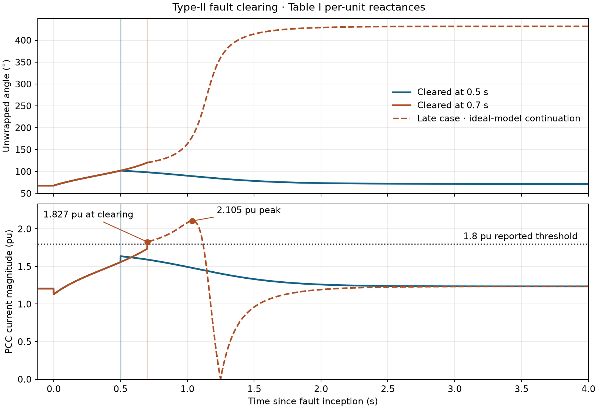

# 2018 PSC 暂态稳定复现

复现 Heng Wu 与 Xiongfei Wang 的 *Design-Oriented Transient Stability Analysis of Grid-Connected Converters With Power Synchronization Control*。论文于 2018 年在线发表，2019 年刊入 IEEE TIE 第 66 卷第 8 期。复现使用单变流器接无穷大母线的一阶 PSC 模型，覆盖式 (5)、Type-I 断线、Type-II 故障清除的临界角与临界时间，以及 Figs. 9–10 对应的约化轨迹。分支以 motulator v0.23.1 上游提交 `ca3fb1f` 为基础，算例脚本独立使用 NumPy、SciPy 和 Matplotlib。[论文 DOI](https://doi.org/10.1109/TIE.2018.2875669) · [作者接收稿](https://arxiv.org/abs/1804.09394v2) · [复现报告](reports/REPORT.md)

## 参数与轨迹

- **标幺主算例**使用表 I 的标幺电抗和 SI 积分增益。以 1 GW 为功率基准，按物理秒积分时系数为 `9.3 rad/s` 每单位功率误差。故障起点 `t=3.0 s` 取自图轴，`0.5 s` 和 `0.7 s` 是故障持续时间，对应 `t=3.5 s` 和 `t=3.7 s` 清除。
- **SI 电感敏感性算例**使用表 I 的舍入亨利值，按推断的 220 kV 相电压 RMS 和 50 Hz 换算标幺电抗。两套参数分别保留，各自包含 Type-I 断线、Type-II 持续故障、0.5 s 清除和 0.7 s 清除。轨迹以 1 ms 采样，保存展开相角、有功功率和 PCC 准稳态相量电流幅值。[冻结参数](configs/protocol.json) · [主运行清单](results/run_manifest.json) · [独立验证参数](verification/protocol.json)

[标幺轨迹图](figures/trajectories_table_pu.png) · [SI 敏感性轨迹图](figures/trajectories_table_si.png) · [相图](figures/phase_portraits.png) · [8 组 NPZ / CSV 轨迹](results) · [独立验证轨迹](verification/trajectories.npz)

## 0.7 s 清除与限流边界

| 表 I 标幺工况 | 清除角 | PCC 电流峰值 | 理想标量模型结果 |
| --- | ---: | ---: | --- |
| 0.5 s 清除 | 102.015° | 1.636 pu | 回到原吸引区的稳定平衡点 |
| 0.7 s 清除 | 120.396° | 2.105 pu | 越过原吸引区边界，滑移一周后再同步 |

标幺主算例的临界清除角和时间分别为 **108.195°** 和 **0.580270 s**，对应故障清除后原同步吸引区的边界。0.7 s 清除时，拓扑切换使模型的 PCC 电流从清除前约 1.735 pu 跳到约 **1.827 pu**，当场超过论文所述的 **1.8 pu** 阈值。

图中虚线表示 0.7 s 算例第一次越过阈值后，继续按同一标量方程求得的轨迹。**2.105 pu 峰值、一次完整相位滑移、随后再同步，以及趋向约 431.805° 的展开相角，都只适用于这一理想模型。** 论文 Fig. 4 描述了限流时切换到 PLL 同步的矢量电流控制。实际触发时刻、限流后的电流峰值、能否再同步及恢复时间，需要限流检测基准、滤波、内环和切换逻辑，以及 EMT 或硬件波形来核验。[来源审计](sources/source_audit.md) · [0.7 s 轨迹 CSV](results/table_pu_type_ii_late.csv)



## 从干净环境复跑

在 macOS 或 Linux shell 中使用 Git 和 Python 3.12。输出写入临时目录。主仿真从冻结协议读取参数。

```sh
run_dir=$(mktemp -d)
git clone --single-branch --branch reproduction/psc-transient-2018 \
  https://github.com/ReproGrid/motulator.git "$run_dir/repo"
case_dir="$run_dir/repo/reproductions/2018_psc_transient"
python3.12 -m venv "$run_dir/env"
py="$run_dir/env/bin/python"
"$py" -m pip install -r "$case_dir/requirements.txt"
export OPENBLAS_NUM_THREADS=1 MPLCONFIGDIR="$run_dir/mpl" PYTHONDONTWRITEBYTECODE=1
out="$run_dir/results"
"$py" "$case_dir/src/reproduce.py" --output "$out" --figures "$out/figures"
"$py" "$case_dir/src/plot_clearing_comparison.py" --results "$out" \
  --output "$out/figures/type_ii_clearing_comparison.png"
printf '%s\n' "$out"
```

主程序运行 34 项数值检查，生成 8 组轨迹。归档平台为 macOS 15.7.4 arm64、Python 3.12.14。在相同平台和依赖下，可与归档数组做严格比对。其他平台以主程序的数值检查为准。[归档复跑结果](results/clean_replay_comparison.json)

```sh
"$py" "$case_dir/src/compare_replay.py" --replay "$out" \
  --output "$run_dir/replay-verification.json"
```

还可在临时克隆中重跑戴维南等效与标量闭式流的独立实现，并用归档主运行及新生成的独立轨迹重建报告。两条命令会更新该克隆中的核验和报告文件。[独立推导说明](verification/independent_notes.md) · [交叉核对结果](results/cross_implementation.json)

```sh
"$py" "$case_dir/verification/verifier.py"
"$py" "$case_dir/src/build_report.py"
```
