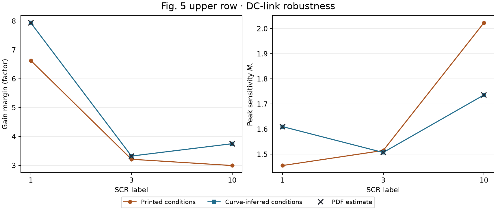

# 2019 Robust Analytic PSC 复现

复现 Harnefors 等人的 *Robust Analytic Design of Power-Synchronization Control*（IEEE TIE，2019）。计算覆盖 Fig. 5、7、8 的频响、极点和稳定裕度，另有 Fig. 5 工作点的小阶跃和附录公式核对。分支从 motulator v0.23.1 的上游提交 `ca3fb1f` 建立，脚本独立使用 NumPy、SciPy 和 Matplotlib。[论文 DOI](https://doi.org/10.1109/TIE.2018.2874584) · [Aalto 作者稿](https://research.aalto.fi/en/publications/robust-analytic-design-of-power-synchronization-control/) · [复现报告](reports/REPORT.md)

## Fig. 5 的两套参数

| 工况 | 上排 `(id0, iq0)`（pu） | 下排 `(id0, iq0)`（pu） | SCR=3 电感（pu） |
| --- | --- | --- | --- |
| 图注 | `(0.95, +0.20)` | `(0.20, −0.95)` | `1/3` |
| 曲线反推 | `(0.95, −0.20)` | `(0.20, −0.95)` | `0.33` |

按论文式 (8)，`iq0>0` 对应吸收无功，`iq0<0` 对应注入无功。另保留仅变号、仅调整 SCR=3 电感两个工况。组合工况和 Aalto 同行评审作者稿的 12 条 Nyquist 矢量轨迹逐条比对，最大 RMS 距离为 `1.48e−5 pu`。原始绘图输入仍待确认。[参数协议](configs/fig5_variants.json) · [对照 CSV](results/fig5_condition_comparison.csv) · [对照 JSON](results/fig5_condition_comparison.json) · [作者稿矢量核对](verification/fig5_vector_comparison.json)

## IEEE 最终出版版与勘误

2026-11-11（UTC）核对了 IEEE Xplore 文章 8490668 的官方 Fig. 5 原图。**符号差异在出版版仍存在。** 两张上排子图都标 `(id0, iq0) = (0.95, +0.20) pu`，但蓝色轨迹整体更吻合 `iq0 = −0.20 pu`。上排直流侧 SCR=10 实线的负实轴交点读值约为 `−0.266 pu`，正号模型预测 `−0.334 pu`，负号模型预测 `−0.267 pu`。仅变号即可让两张上排子图的像素拟合 RMS 误差分别降低约 6.6 倍和 8.6 倍。[IEEE Xplore Figures](https://ieeexplore.ieee.org/document/8490668/figures) · [官方原图](https://ieeexplore.ieee.org/mediastore/IEEE/content/media/41/8678530/8490668/harne5-2874584-large.gif) · [出版版量取数据](verification/fig5_ieee_comparison.json)

在 IEEE 最终版 PDF 的第 5 页（期刊印刷页 5814），四个子图的标注、线型和曲线与官网原图一致。按各子图刻度对齐后，GIF 蓝色像素到 PDF 矢量轨迹的 RMS 距离为 `0.0051–0.0056 pu`，约为一个 GIF 像素。PDF 上排直流侧 SCR=10 实线交点为 `−0.26663 pu`，进一步确认了符号差异。[PDF 与官网原图的对照数据](verification/fig5_ieee_pdf_comparison.json)

截至该日未查到公开登记的关联勘误。Crossref 的 DOI 记录没有关联更新，反查返回 0 条，Crossmark 未提供该 DOI 的状态数据。[Crossref DOI 记录](https://api.crossref.org/works/10.1109/TIE.2018.2874584) · [反查更新](https://api.crossref.org/works?filter=updates%3A10.1109%2FTIE.2018.2874584&rows=0) · [Crossmark](https://crossmark.crossref.org/dialog/?doi=10.1109%2FTIE.2018.2874584)

## 符号差异影响的结论

- **第 V-B 节的直流侧灵敏度排序。** Fig. 5 上排按峰值从低到高，图注给出 SCR 1 → 3 → 10，曲线反推给出 SCR 3 → 1 → 10。单独变号即可翻转排序，单独调整电感时排序与图注相同。作者稿以 SCR=3 的灵敏度峰值最低解释直流电压响应，负号工况支持这项频域解释。第 V-B 节实验的有功电流约为 0.6 pu，Fig. 5 上排使用 0.95 pu，实验响应排序仍待核验。
- **裕度和带宽的数值。** SCR=10 上排的直流侧增益裕度从 2.994 倍变为 3.750 倍，作者稿曲线读值约 3.751 倍。SCR=1 上排的有功闭环 −3 dB 带宽从 0.29541 pu 变为 0.18594 pu。SCR=1 下排高无功注入的带宽仍约为 0.01003 pu，直流侧相位裕度为 13.51°。
- **稳定性与其他计算结论。** 两套参数下六个工作点的有功环和直流侧环均稳定，有功增益裕度均大于 2 倍。两排的有功相位裕度都在 SCR=10 最小，支持第 V-A 节对强网相位裕度偏小的解释。Fig. 7–8 使用独立工作点。附录在其冻结滤波器假设下的裕度下界经重新推导后仍成立。[Fig. 7–8 对照图](figures/fig7_8_nyquist.png) · [附录推导](verification/independent_derivation.md)



[Nyquist 叠图](figures/fig5_parameter_overlay.png) · [图注工况频响](results/frequency_responses.npz) · [图注小阶跃](results/local_steps.npz) · [反推工况小阶跃](results/fig5_curve_inferred_local_steps.npz)

## 硬件验证范围

Figs. 9–10 是论文的实验装置和接线。Figs. 11–13 的有功阶跃、Fig. 14 的频率变化以及 Figs. 15–17 的直流侧电压阶跃均未在实机复放，也未验证绝对上升时间、过冲或逐点波形。模型采用连续平均方程，时域结果是工作点附近的小阶跃。硬件核验缺少原始测量、限流器设置、有效阻抗、采样及计算延迟、PWM 时序。表 I 给出的 `Ra=4.4 Ω` 按 `Zbase=12.6 Ω` 折算为 `0.3492 pu`，表中标的是 `0.2 pu`。主算例采用论文的 `0.2 pu` 设计值，运行清单另存了 `0.3492 pu` 的灵敏度测试，实机设置待确认。[来源审计](sources/source_audit.md) · [运行清单](results/run_manifest.json)

## 从干净环境复跑

在 macOS 或 Linux 的 shell 中运行以下命令，需要 Git 和 Python 3.12。输出写入临时目录。主计算读取仓库里的矢量核对摘要。

```sh
run_dir=$(mktemp -d)
git clone --single-branch --branch reproduction/psc-robust-2019 \
  https://github.com/ReproGrid/motulator.git "$run_dir/repo"
case_dir="$run_dir/repo/reproductions/2019_psc_robust"
python3.12 -m venv "$run_dir/env"
py="$run_dir/env/bin/python"
"$py" -m pip install -r "$case_dir/requirements.txt"
export OPENBLAS_NUM_THREADS=1 MPLCONFIGDIR="$run_dir/mpl" PYTHONDONTWRITEBYTECODE=1
out="$run_dir/results"
"$py" "$case_dir/src/reproduce.py" --output "$out" --figures "$out/figures"
"$py" "$case_dir/src/compare_fig5_conditions.py" --output "$out" --figures "$out/figures"
"$py" "$case_dir/verification/verify_fig8.py" --primary "$out" \
  --output "$out/fig8_independent_comparison.json"
printf '%s\n' "$out"
```

三条计算命令分别校验图注工况、四工况比较和 Fig. 8 的独立模型。归档运行通过 50 项数值检查（42 项基础检查和 8 项 Fig. 5 对照检查）。在归档平台 macOS 15.7.4 arm64、Python 3.12.14 上，可再执行严格比对，检查数组误差及 CSV、指定 JSON 和 PNG 的字节一致性。其他平台以各计算命令中的数值检查为准。[归档检查摘要](reports/status.json) · [严格比对结果](results/clean_replay_comparison.json)

```sh
"$py" "$case_dir/src/compare_replay.py" --replay "$out" \
  --output "$run_dir/replay-verification.json"
```

可用 `"$py" "$case_dir/verification/verifier.py"` 重新运行独立状态空间模型。该命令会更新临时克隆中 `verification/` 下的结果。若要从 PDF 重新提取 Fig. 5 的矢量数值，下载下方来源清单里的固定版本，用 `--pdf` 指向文件，脚本会检查 SHA-256。[独立核验](verification/verification_report.md) · [来源清单](sources/source_manifest.json) · [Aalto 作者稿 PDF](https://aaltodoc.aalto.fi/server/api/core/bitstreams/c8da5953-833c-4f32-b38b-49ea7add52b9/content)

```sh
"$py" -m pip install pymupdf==2.1
"$py" "$case_dir/verification/compare_fig5_manuscript.py" \
  --pdf /path/to/robust_psc2019.pdf --out "$run_dir/fig5-vector-check.json"
```

用从 IEEE Xplore Figures 栏保存的原尺寸 GIF 复跑出版版量取。脚本会检查原图的 SHA-256。仓库保存了量取数据和脚本。[出版版量取脚本](src/compare_fig5_ieee.py)

```sh
"$py" "$case_dir/src/compare_fig5_ieee.py" \
  --artwork /path/to/harne5-2874584-large.gif --output "$run_dir/fig5-ieee-check.json"
```

如需复跑 PDF 与官网原图的对照，使用通过 IEEE Xplore 获得的最终版 PDF 和同一 GIF，另需上述 PyMuPDF 依赖。[PDF 对照脚本](src/compare_fig5_ieee_pdf.py)

```sh
"$py" "$case_dir/src/compare_fig5_ieee_pdf.py" \
  --pdf /path/to/robust_psc2019_ieee.pdf \
  --artwork /path/to/harne5-2874584-large.gif \
  --output "$run_dir/fig5-ieee-pdf-check.json"
```
