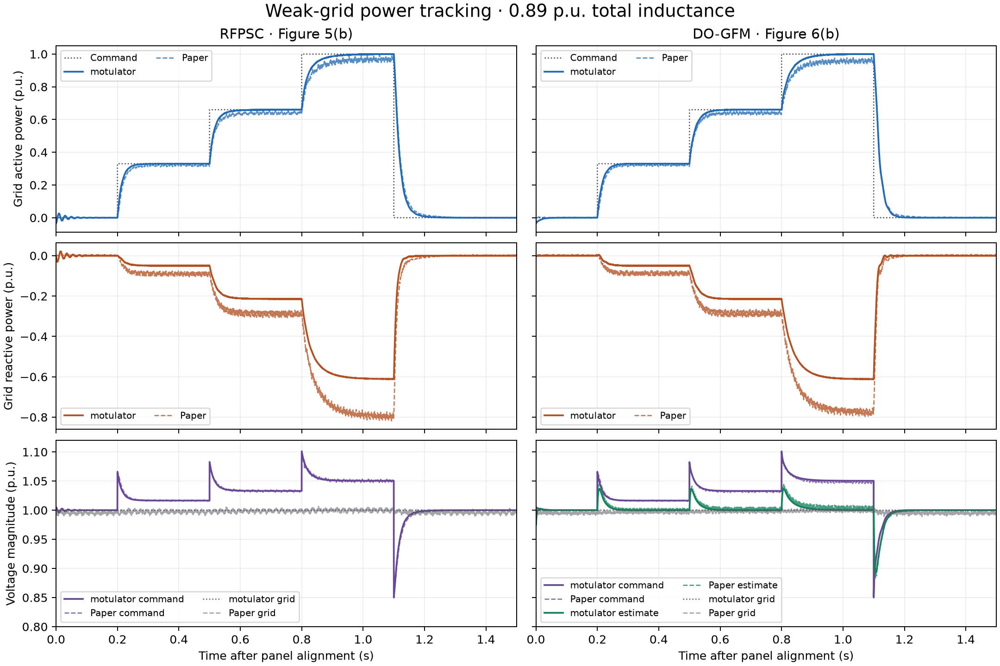

# Weak-grid DO-GFM and RFPSC reproduction

ReproGrid simulated the weak-grid power-step comparison in Figures 5(b) and 6(b) of Nurminen et al. with motulator v0.23.1. RFPSC rises faster after the rated active-power command and DO-GFM returns to zero faster in both the simulation and the published traces. Both simulated controllers have shorter rise times and absorb less reactive power than the laboratory measurements. [Paper DOI](https://doi.org/10.1109/TPEL.2024.3433503) · [Open paper](https://acris.aalto.fi/ws/portalfiles/portal/162149547/Multifunctional_Grid-Forming_Converter_Control_Based_on_a_Disturbance_Observer.pdf)

**中文摘要**　两组均按表 I、II 配置，在 0.89 p.u. 弱网下复现了 RFPSC 升功率更快、DO-GFM 回零更快的顺序。额定阶跃上升时间分别比论文实验短约 29 ms 和 43 ms，满功率无功吸收幅度分别小约 0.184 p.u. 和 0.164 p.u.。下方命令可复跑仿真、指标和叠图。



[Download PNG](results/fig5b_fig6b_comparison.png) · [Download SVG](results/fig5b_fig6b_comparison.svg)

## Replay

Install Git and Python 3.12, then run these commands in a shell. The separate Git worktree provides the exact upstream code at `ca3fb1f225be30ff98d70ebca6fc49cc24e2bb2e`. The runner verifies that commit and checks the tracked files before importing motulator.

```sh
run_dir=$(mktemp -d)
repo_dir="$run_dir/reprogrid-motulator"
case_dir="$repo_dir/reproductions/2024_do_gfm"

git clone --single-branch --branch reproduction/do-gfm-rfpsc-2024 \
  https://github.com/ReproGrid/motulator.git "$repo_dir"
git -C "$repo_dir" worktree add --detach "$run_dir/motulator-base" \
  ca3fb1f225be30ff98d70ebca6fc49cc24e2bb2e
python3.12 -m venv "$run_dir/env"
"$run_dir/env/bin/python" -m pip install -r "$case_dir/requirements.txt"
OPENBLAS_NUM_THREADS=1 MPLCONFIGDIR="$run_dir/mpl" \
  "$run_dir/env/bin/python" "$case_dir/reproduce.py" \
  --checkout "$run_dir/motulator-base" --output "$run_dir/results"
```

The runner writes the four simulation CSVs, metrics JSON and both plot formats to `$run_dir/results`. It runs switched, solver-refined and averaged cases for each controller. On the recorded macOS arm64 host, a clean replay regenerated the four CSVs, metrics JSON and PNG byte for byte. [Replay verification](results/replay_verification.json)

The digitized reference CSVs are included. To regenerate them, download the Aalto PDF linked above and use NumPy 2.5.4 and PyMuPDF 2.1 with the [digitizer](reference/extract_weak_grid_figures.py). The digitizer verifies the PDF hash and accepts `--pdf` and `--out`.

## Conditions and results

The simulation uses a 6.3 mH filter, a 650 V DC bus, 10 kHz control sampling and 5 kHz PWM. The total inductance is 0.89 p.u. and the observer uses a 0.15 p.u. estimate. Both controllers receive the same 0, 0.33, 0.66, 1 and 0 p.u. active-power sequence, with steps at 0.2, 0.5, 0.8 and 1.1 s. The protocol records the gains from Table II, the source of each assumption, and the per-unit conventions. [Protocol](protocol.json) · [Full metrics and SI parameters](results/metrics.json)

| Metric | RFPSC simulation / Fig. 5(b) | DO-GFM simulation / Fig. 6(b) |
| --- | ---: | ---: |
| 0.66 to 1 p.u. active-power rise time, ms | 61.0 / 89.7 | 67.0 / 109.6 |
| 1 to 0 p.u. active-power fall time, ms | 38.8 / 44.0 | 34.8 / 35.6 |
| Rated-command plateau active power, p.u. | 1.000 / 0.969 | 1.000 / 0.961 |
| Rated-command plateau reactive power, p.u. | −0.611 / −0.795 | −0.611 / −0.775 |

Rise and fall times use the 10% and 90% thresholds of the commanded step. Plateau values average the final 50 ms before the next command. P and Q are evaluated at the grid-emulator terminals. The simulation plots use a centered one-carrier-period average. Each paper trace is translated to align its first command edge, with the measured amplitudes preserved. The digitization resolution is approximately 0.4 ms. [Digitization and clock offsets](reference/paper_metrics.json)

| Controller | Switched model | Averaged model | Paper vector digitization |
| --- | --- | --- | --- |
| RFPSC | [CSV](results/fig5b_rfpsc_switched.csv) | [CSV](results/fig5b_rfpsc_averaged.csv) | [CSV](reference/fig5b_rfpsc.csv) |
| DO-GFM | [CSV](results/fig6b_do_gfm_switched.csv) | [CSV](results/fig6b_do_gfm_averaged.csv) | [CSV](reference/fig6b_do_gfm.csv) |

## Differences from the laboratory experiment

- **Controller implementation.** motulator uses the Eq. (13) feedback gains with a fixed-frame discrete observer. The laboratory DO-GFM implementation uses Eq. (19) in the estimated-voltage frame. The stock RFPSC controller uses realized PWM voltage and estimated resistive losses in its power feedback. Appendix C expresses the power feedback using the command-voltage product. [Pinned motulator source](https://github.com/Aalto-Electric-Drives/motulator/tree/ca3fb1f225be30ff98d70ebca6fc49cc24e2bb2e)
- **Plant and instrumentation.** The model uses a balanced ideal grid source and fixed DC voltage. The reported 0.05 p.u. resistance estimate also serves as the physical series resistance in the model. The run uses ideal switching with zero dead time, and the 1.3 p.u. limit taken from Figure 8 never activates. The lab emulator dynamics, DC supply dynamics, sensor filtering and dead time for Figures 5 and 6 are unspecified in the paper.
- **Numerical comparison.** Refining the solver changed any plotted signal by at most 0.000055 p.u. The switched and averaged Q traces differed by less than 0.00015 p.u. RMS. Both effects are small relative to the 0.16–0.18 p.u. difference in the rated Q plateau. The simulated plateau is close to the ideal loss-compensated equilibrium of −0.611 p.u. at 1 p.u. power. The available data leave the cause of the remaining experimental gap open. [Metrics](results/metrics.json)

## Attribution

The reference CSVs, reference metrics and published-trace portions of the comparison plots adapt Figures 5(b) and 6(b) of *Multifunctional Grid-Forming Converter Control Based on a Disturbance Observer* by Tuure Nurminen, Rayane Mourouvin, Marko Hinkkanen and Jarno Kukkola, IEEE Transactions on Power Electronics 39(10), pp. 13023–13032, 2024. © 2024 The Authors. ReproGrid digitized and resampled the figure vectors, translated each time axis to align the first command edge, and overlaid the traces with new simulations. The adapted published traces are provided under CC BY 4.0. The replay code uses the repository's MIT license. [Original paper](https://doi.org/10.1109/TPEL.2024.3433503) · [CC BY 4.0](https://creativecommons.org/licenses/by/4.0/) · [MIT license](../../LICENSE)
